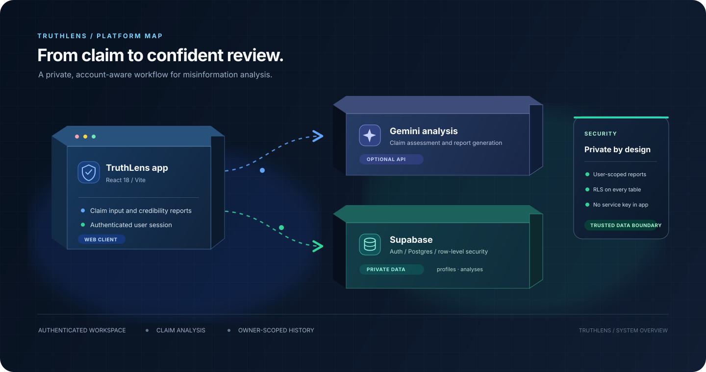

<div align="center">

# TruthLens

### Misinformation Analysis Assistant

Review online claims, inspect credibility reports, and keep your analysis history with a private account.

[Features](#features) · [Architecture](#architecture) · [Setup](#setup) · [Scripts](#available-scripts) · [Security](#data-and-security)

</div>

<p align="center">
  
</p>

## Overview

TruthLens is a React web application for analyzing claims and articles. It combines a Gemini-powered analysis workflow with Supabase authentication and per-user report storage.

> Analysis results are informational. Review primary sources and supporting evidence before relying on a verdict.

## Features

- **Claim analysis:** Submit a URL or text for a structured credibility report.
- **Reports:** Review a claim's verdict, score, confidence, metrics, extracted claims, and explanations.
- **Dashboard and history:** Browse saved reports and export scan history as CSV.
- **Accounts:** Create an account, sign in, update your display name, and sign out using Supabase Auth.
- **Private report storage:** Save each user's reports to Supabase Postgres with row-level security.
- **Administrator view:** Display the account directory to admins; administrator access does not expose other users' analyses.
- **Source watchlist and extension simulator:** Explore the source-related and browser-extension demonstration screens in the app.
- **Marketing preview:** View the public-facing landing page and example analysis experience.

## Architecture

1. **React + Vite client** renders the landing page, dashboard, analysis flow, reports, history, source watchlist, extension simulator, and account settings.
2. **Gemini API** processes analysis prompts when `VITE_GEMINI_API_KEY` is configured.
3. **Supabase Auth** manages email/password sessions and user identity.
4. **Supabase Postgres** stores profile rows and JSON-formatted analysis reports.
5. **Row-level security (RLS)** restricts saved analysis access to its owner.

The [architecture illustration](./docs/truthlens-architecture.svg) shows the app, analysis, storage, and security boundaries.

## Technology

| Area | Technology |
| --- | --- |
| Frontend | React 18, Vite 6 |
| UI icons | Lucide React |
| Authentication and database | Supabase Auth, Supabase Postgres |
| Database access | `@supabase/supabase-js` |
| Claim analysis | Google Gemini API |

## Setup

### Requirements

- Node.js 18 or later
- npm
- A Supabase project
- A Gemini API key for live analysis

### 1. Install dependencies

```bash
npm install
```

### 2. Configure environment variables

Copy `.env.example` to `.env`, then replace the placeholder values:

```env
VITE_SUPABASE_URL=https://dtduvvlhqvnhdwdkcvic.supabase.co
VITE_SUPABASE_ANON_KEY=your_supabase_publishable_or_anon_key
VITE_GEMINI_API_KEY=your_gemini_api_key
```

The Supabase URL is preconfigured for the project connected to this app. Use the project's publishable/anon key. The local `.env` file is excluded from Git.

### 3. Configure Supabase

The connected project has been provisioned with the required tables and policies. For a new Supabase project, run [`supabase/schema.sql`](./supabase/schema.sql) in the Supabase SQL Editor.

The schema sets up:

- `public.profiles` for account email, display name, and role.
- `public.analyses` for each user's saved analysis JSON.
- A trigger to create or synchronize a profile when an Auth user is created or updated.
- RLS policies and grants for user-scoped data access.

The schema can be run again to re-create or update policies and triggers. It does not delete profile or analysis records.

### 4. Start the development server

```bash
npm run dev
```

Open the local URL printed by Vite. Create an account or sign in to use the authenticated app.

## Available scripts

| Command | Description |
| --- | --- |
| `npm run dev` | Start the Vite development server. |
| `npm run build` | Build the production frontend into `dist/`. |
| `npm run preview` | Serve the production build locally for preview. |

## Administrator access

New accounts receive the `user` role. To promote an account, first register it, then run this statement in the Supabase SQL Editor:

```sql
update public.profiles
set role = 'admin'
where email = 'your-account@example.com';
```

The account settings page shows the role and, for administrators, the account directory. Change roles through Supabase rather than the client app.

## Data and security

- Analysis reports are saved as JSON in `public.analyses`, with an owner ID and analysis ID.
- Authenticated users can access their own analyses; RLS also restricts updates and deletes by owner.
- The account directory is protected by profile-table RLS and is available to administrators.
- Admin access to profiles does not grant access to other users' analysis reports.
- The browser client uses the Supabase publishable/anon key. **Never expose a Supabase service-role key in the frontend or commit secrets.**
- Gemini prompts are sent to the configured Google Gemini API when live analysis is used.
- Do not store passwords or API secrets in application tables or report records.

## Project structure

```text
.
├── docs/
│   └── truthlens-architecture.svg   Architecture illustration
├── src/
│   ├── components/                  Shared UI and authentication components
│   ├── data/                        Example analysis data
│   ├── services/                    Gemini and Supabase integrations
│   ├── views/                       Application screens
│   ├── App.jsx                      Authentication and app view orchestration
│   ├── index.css                    Application styles
│   └── main.jsx                     Frontend entry point
├── supabase/
│   └── schema.sql                   Database schema, trigger, grants, and RLS
├── .env.example                     Environment variable template
├── index.html                       Vite HTML entry point
├── package.json                     Dependencies and npm scripts
└── vite.config.js                   Vite configuration
```

## License

This repository does not currently include a license file. Add an appropriate license before redistributing the project.
